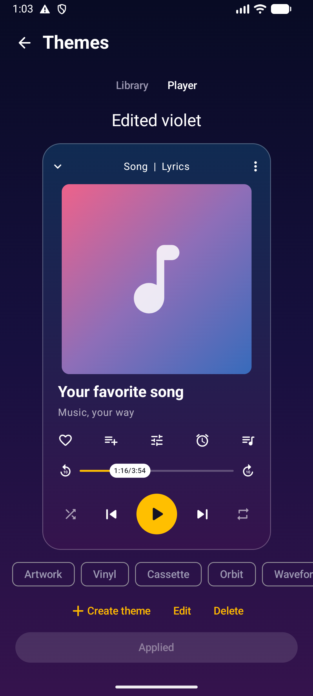
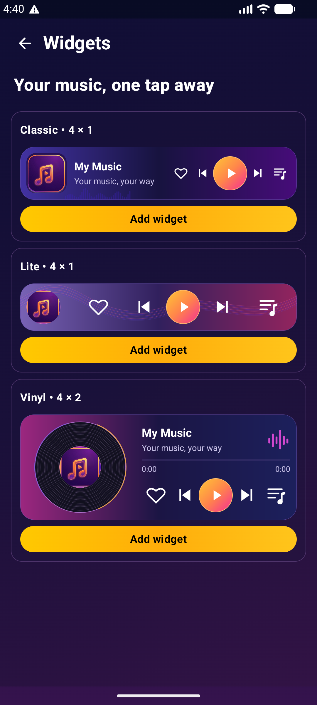

# My Music

An offline Android music player built with Kotlin, Jetpack Compose, and Media3. Browse your local library, personalize your player, and keep your music within reach.

**No ads, in-app purchases, accounts, analytics, or internet permission.**

## Features

- **Your library:** songs, playlists, folders, albums, artists, search, sorting, bulk actions, scan filters, and hidden folders.
- **Playback:** drag-to-reorder queue, shuffle, repeat, seeking, speed controls, crossfade, gapless playback, and notification and lock-screen controls.
- **For you:** top picks, recently played songs, artist and album mixes, daily discovery, never-played songs, year-based collections, high-quality audio, and monthly charts. Recommendations stay on-device. Disabling the section stops tracking and keeps saved data until you explicitly clear it.
- **Personalization:** player themes, cover-derived colors, animated artwork layouts, custom player and library palettes, and Classic, Lite, and Vinyl home-screen widgets.
- **Audio and lyrics:** ten-band equalizer, five-band control mode, supported Android audio effects, sleep timer, and plain-text or LRC lyrics with timestamp seeking.
- **Library tools:** sharing, ringtone assignment, Android-confirmed deletion, local metadata and artwork editing, supported MP3 tag writing, JSON backup and restore, and local music-package import and export.

## Screenshots

| Player themes | Widgets |
| :---: | :---: |
|  |  |

Screenshots show the app running in an Android emulator. Widget placement and available space depend on the launcher.

## Getting started

Install a signed APK and grant audio-library access when prompted. Add audio using your device's file manager, then use **Scan music**. You can also open supported audio files directly with My Music.

File edits and deletion request Android consent where required. MP3 tag writing retains original-file backups under **Backup & restore → Original file backups**.

## Build

Requirements:

- Android SDK with platform 37.
- JDK 25, pinned by `gradle/gradle-daemon-jvm.properties`.
- Gradle 9.3.1, provided by the checked-in wrapper with distribution checksum verification.

On Windows PowerShell, configure your existing SDK in the ignored `local.properties` file:

```properties
sdk.dir=C:/path/to/Android/Sdk
```

Build the debug APK:

```powershell
.\gradlew.bat :app:assembleDebug
```

Output: `app/build/outputs/apk/debug/app-debug.apk`.

With your SDK's platform-tools on PATH, install on a chosen emulator or device:

```powershell
adb -s <device-serial> install -r app/build/outputs/apk/debug/app-debug.apk
```

The debug APK uses the local Android debug key. `:app:assembleRelease` builds an unsigned release APK; configure your own signing key for distribution. Build outputs, local IDE state, and signing credentials are excluded from Git.

Application ID: `my.music`. Minimum Android version: 7.0 (API 24). Target API: 36. Version: 1.0.0, version code 2. See [release notes](RELEASE_NOTES.md).

## Development

- [Architecture and data ownership](DESIGN.md)
- [Testing](docs/TESTING.md)
- [Recommendation behavior](docs/RECOMMENDATIONS.md)
- [Recorded verification](docs/VERIFICATION.md)

## Compatibility

Playback support depends on the device's available decoders and audio-effect capabilities. The interface is currently English.

Source-file tag writing supports ordinary ID3v2.3/v2.4 MP3 files up to 128 MB. Unsupported extended or unsynchronised tags are rejected before modification. Artwork edits and metadata changes for other formats are stored locally in the app.

Music transfer uses a local ZIP package with integrity checks. Recommendation counters are separate from playlist history and are not included in the current backup format.

Runtime testing currently covers an API 37 emulator. Older Android versions, physical headsets, other launchers, paired-device transfer, exhaustive codec support, and captured audio-output quality require additional validation. See the verification report for the scope of each recorded run.
